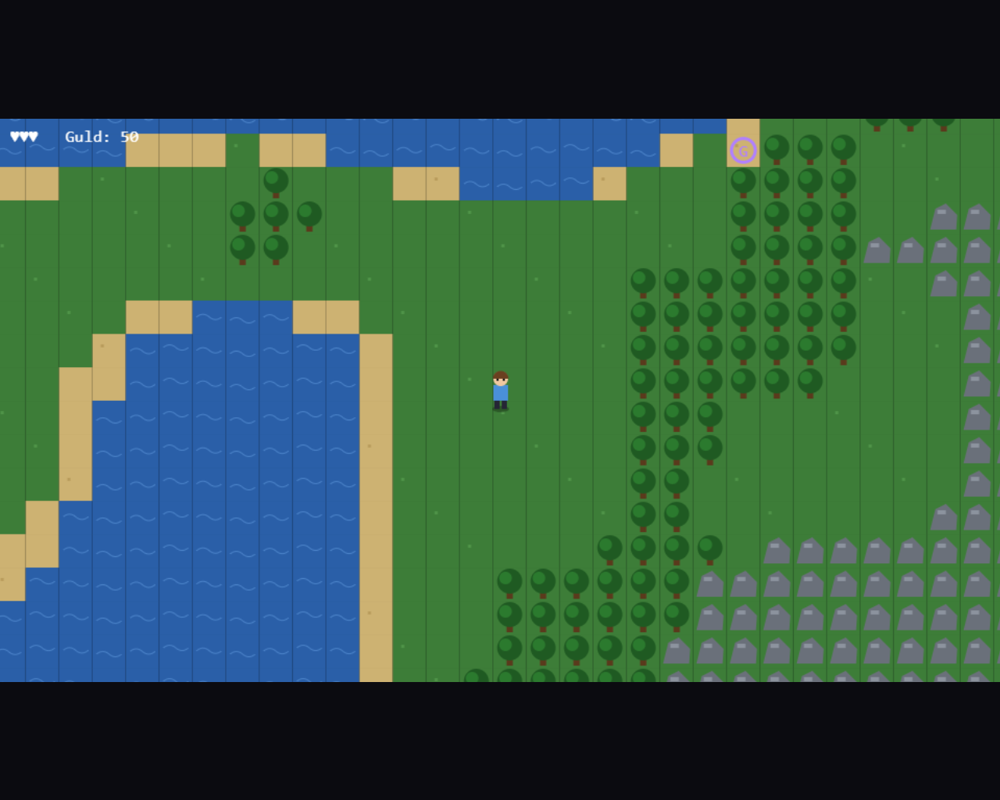

# Adventure Game Template

A minimalist HTML5 Canvas framework for building adventure games in a single self-contained HTML file.



## Overview

This project provides a compact game-development foundation built around a scene-based architecture, deterministic procedural generation, and centralized content registries.

All game systems, assets, and gameplay logic are contained within a single file for simplicity, portability, and ease of experimentation.

---

## Features

- HTML5 Canvas rendering
- Scene-based game architecture
- Deterministic world generation
- Seed-driven procedural content
- Tile-based movement and collisions
- Shared player controller
- Keyboard input abstraction
- Built-in audio and music synthesis
- Dialog and menu system
- JSON-serializable game state
- No external runtime dependencies

---

## Available Scenes

| Scene | Purpose |
|---------|---------|
| Title | Main menu and startup |
| World | Procedurally generated overworld |
| Town | NPC interaction area |
| Cave | Enemy encounter zone |
| Ruins | Side-scrolling platform prototype |
| Airfield | Vertical flight prototype |

---

## Content Registries

The framework organizes data through centralized registries.

| Registry | Purpose |
|-----------|---------|
| SCENES | Scene definitions |
| BLOCKS | Tile definitions |
| PORTALS | Area transitions |
| NPCS | NPC data and dialogs |
| ENEMIES | Enemy definitions |
| TRACKS | Music tracks |
| SFX | Sound effects |

---

## Deterministic World Generation

All generated content originates from:

```javascript
G.seed
```

This allows:

- Reproducible worlds
- Consistent gameplay across sessions
- Lightweight save files
- Easier debugging and testing

---

## State Model

Persistent game state:

```javascript
G
```

Runtime-generated world data:

```javascript
WORLD
```

Only the persistent state is intended to be saved and restored.

---

## Input Mapping

| Action | Keys |
|----------|----------|
| Move | WASD / Arrow Keys |
| Confirm | Space / Z |
| Cancel | Escape / X |
| Pause | Enter |
| Mute | M |

Game logic interacts with abstract actions rather than raw keyboard codes.

---

## Audio System

The framework includes a built-in procedural audio engine.

Features include:

- Synthesized sound effects
- Procedural music generation
- Scene-specific music tracks
- Global mute functionality

No external audio assets are required.

---

## Extending the Template

New content is typically added through registry sections:

```text
[REG:*]
```

New playable areas ca* be added through*

```text
[SCENE:*]
```

Core subsystems are intended to remain stable:

```text
CORE
INPUT
RNG
STATE
AUDIO
GFX
UI
```

---

## Current Implementation Status

Implemented:

- Core engine
- Scene management
- World generation
- NPC interactions
- Enemy behaviors
- Area transitions
- Platforming prototype
- Flight prototype

Placeholder systems:

- Save / Load
- Combat

---

## Internal Structure

```text
Mall0.html
├── CORE
├── INPUT
├── RNG
├── STATE
├── AUDIO
├── GFX
├── UI
├── BLOCK REGISTRY
├── PORTAL REGISTRY
├── NPC REGISTRY
├── ENEMY REGISTRY
├── TITLE SCENE
├── WORLD SCENE
├── ROOM SYSTEM
├── RUINS SCENE
├── AIRFIELD SCENE
└── BOOT
```

---

## Goal

Provide a lightweight and extensible foundation for experimenting with:

- Adventure games
- RPG mechanics
- Procedural exploration
- Platforming gameplay
- Arcade-style systems

while keeping the entire project contained in a single, easy-to-understand HTML file.
